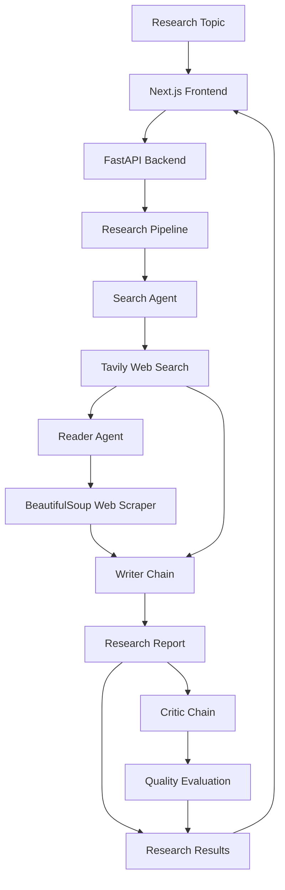

# NEXUS — Multi-Agent AI Research System

**Turn research topics into structured intelligence using four specialized AI stages.**

NEXUS is a full-stack AI research application that automates web research, webpage extraction, report generation, and quality evaluation through a sequential multi-agent workflow.

<p align="center">
  **[Live Demo](https://multi-agent-research-system-ten-neon.vercel.app/) · [GitHub Repository](https://github.com/sharonyobhattacharjee/multi-agent-research-system)**
</p>

## Overview

Rather than relying on a single LLM response, NEXUS divides research into four specialized stages:

| Stage | Component | Responsibility |
|---|---|---|
| 01 | Search Agent | Finds relevant web sources using Tavily |
| 02 | Reader Agent | Extracts useful information from webpages |
| 03 | Writer Chain | Generates a structured research report |
| 04 | Critic Chain | Evaluates the report and provides feedback |

The system uses Google Gemini for language-model operations, LangChain for agent orchestration, and a FastAPI backend connected to a Next.js frontend.

## Architecture



**Agent implementation:** The Search and Reader stages use LangChain tool-calling agents. The Writer and Critic stages use LangChain Expression Language (LCEL) chains.

## Features

- **Web research:** Search for relevant information and source URLs.
- **Content extraction:** Retrieve and parse webpage content.
- **AI report generation:** Produce structured reports with key findings and conclusions.
- **Quality evaluation:** Generate a score, strengths, improvement areas, and verdict.
- **Research transparency:** View search results, extracted content, sources, and evaluation separately.
- **Full-stack architecture:** Next.js frontend, FastAPI backend, and Python research pipeline.
- **Cloud deployment:** Deployed on Vercel.

## Tech Stack

| Layer | Technologies |
|---|---|
| Frontend | Next.js, React, TypeScript, Tailwind CSS |
| Backend | Python, FastAPI, Pydantic |
| AI & Orchestration | Google Gemini, LangChain, LCEL |
| Web Research | Tavily Search API |
| Web Scraping | Requests, BeautifulSoup |
| Deployment | Vercel |
| Version Control | Git, GitHub |

## Project Structure

```text
multi-agent-research-system/
│
├── backend/
│   └── main.py             # FastAPI application
│
├── frontend/
│   └── src/
│       └── app/
│           ├── page.tsx    # Main research dashboard
│           ├── layout.tsx
│           └── globals.css
│
├── agents.py               # Agent and LCEL chain definitions
├── tool.py                 # Tavily search and webpage scraper
├── pipeline.py             # Research workflow orchestration
├── app.py                  # Original Streamlit interface
│
├── requirements.txt        # Python dependencies
├── vercel.json             # Multi-service deployment config
└── .gitignore
```

## Getting Started

### Prerequisites

- Python 3.11+
- Node.js and npm
- Google Gemini API key
- Tavily API key

### 1. Clone the repository

```bash
git clone https://github.com/sharonyobhattacharjee/multi-agent-research-system.git

cd multi-agent-research-system
```

### 2. Set up the Python environment

```bash
python -m venv .venv
```

Activate the environment:

**macOS / Linux**
```bash
source .venv/bin/activate
```

**Windows**
```bash
.venv\Scripts\activate
```

Install dependencies:

```bash
pip install -r requirements.txt
pip install "uvicorn[standard]" lxml
```

### 3. Configure environment variables

Create a `.env` file in the project root:

```env
GEMINI_API_KEY=your_gemini_api_key
TAVILY_API_KEY=your_tavily_api_key
```

Get your API keys:

- [Google AI Studio](https://aistudio.google.com/)
- [Tavily](https://tavily.com/)

Never commit your `.env` file or expose API keys in frontend code.

### 4. Start the backend

From the project root:

```bash
python -m uvicorn backend.main:app --reload --port 8000
```

Backend: `http://localhost:8000`

API documentation: `http://localhost:8000/docs`

### 5. Start the frontend

Open another terminal:

```bash
cd frontend
npm install
npm run dev
```

Frontend: `http://localhost:3000`

For local full-stack development, configure a Next.js rewrite for `/api/:path*` to forward requests to `http://127.0.0.1:8000/api/:path*`. The production Vercel configuration already handles this routing.

## API Reference

### Health Check

`GET /api/health`

Response:

```json
{
  "status": "healthy"
}
```

### Run Research

`POST /api/research`

Request:

```json
{
  "topic": "The future of autonomous AI agents"
}
```

Response:

```json
{
  "status": "success",
  "topic": "The future of autonomous AI agents",
  "report": "Generated research report...",
  "feedback": "Critic evaluation...",
  "search_results": "Collected search results...",
  "scraped_content": "Extracted webpage content..."
}
```

## Deployment

NEXUS uses Vercel's multi-service configuration:

- **Frontend:** Next.js application in `frontend/`.
- **Backend:** Python FastAPI application, with entrypoint `backend.main:app`.
- **Routing:** `/api/*` requests are forwarded to the backend; other requests are served by the frontend.

Configure `GEMINI_API_KEY` and `TAVILY_API_KEY` in Vercel's Environment Variables settings.

**Live application:** [NEXUS](https://multi-agent-research-system-ten-neon.vercel.app/)

## Future Improvements

- Parallel agent execution.
- Iterative report refinement based on critic feedback.
- Live agent progress and streaming responses.
- Persistent research history.
- Structured source citations and verification.
- PDF and Markdown report export.
- Authentication and user workspaces.
- Background execution for long-running research tasks.

---

**Built by [Sharonyo Bhattacharjee]**

